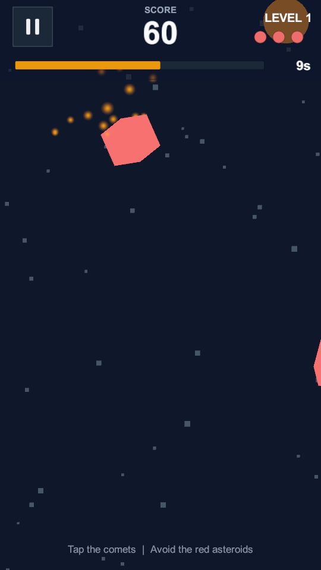
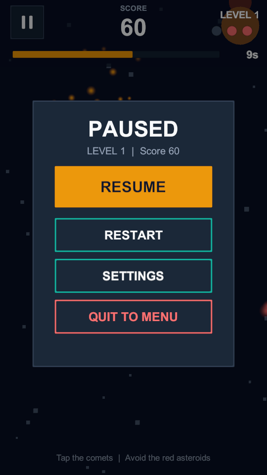
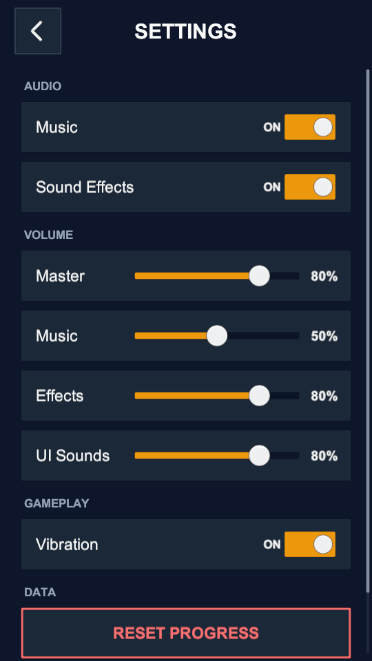
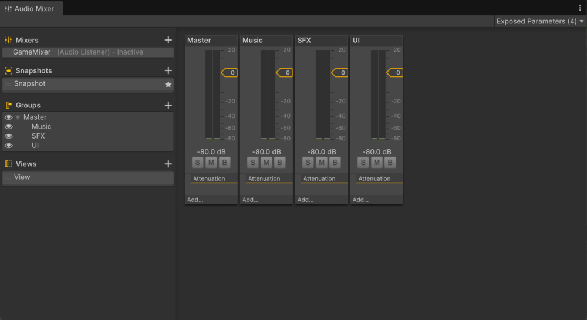

# Comet Run – ITU CS-464 Lab 08 (BSSE23041)

This is my Lab 07 project (Comet Run, the 10 screen mobile menu flow) with Lab 08 added on top:
a loading screen, a real small game behind the gameplay HUD, sounds, music, an Audio Mixer with
volume settings, and C# events.


**Unity version:** 6000.3.24f1 (Built in render pipeline, portrait, made for Android)

| Loading | Gameplay | Pause | Settings | Results |
|---|---|---|---|---|
|  |  |  |  |  |

---

### The game (very simple, only Unity basic shapes)

Orange balls (comets) fall from the top. Tap them for points. Gold balls give double points and
+2 seconds. Red spinning cubes are asteroids – tapping one costs a life, and you have 3 lives.
The run ends when the timer reaches 0 or you lose all lives. Your score decides the gems on the
Results screen like before.

Everything in the game scene is a primitive (Sphere, Cube, Quad) with a flat Unlit/Color material.
There are no imported models or sprites.

### Full flow

Title → Main Menu → Mode Select → Level Select → Hangar → **Loading** → Gameplay → Pause / Settings →
Results → Next level / Retry (loads again) / Menu.
From Pause you can also Restart or Quit to Menu.

---

## 1. Loading system

Script: `Scripts/Runtime/Screens/LoadingScreen.cs` and `Scripts/Runtime/Game/GameSceneLoader.cs`

- The menus are in `Main.unity` and the actual game is in its own scene, `Gameplay.unity`.
- When you press **START RUN** in the Hangar, the Loading screen opens and calls
  `SceneManager.LoadSceneAsync("Gameplay", LoadSceneMode.Additive)`.
- I load it **additively** (on top of the menu scene) so the screen manager, pause, settings and
  results from Lab 07 keep working without any changes to the navigation.
- `allowSceneActivation` is set to `false`, so the scene can't switch on by itself. Unity stops the
  progress at 0.9 while waiting, so the bar shows `progress / 0.9` as 0–100%.
- The bar is smoothed a bit so it doesn't jump straight from 0 to 100, but it is never ahead of the
  real progress.
- Only when the bar is full do I set `allowSceneActivation = true`, wait for `isDone`, and then open
  the Gameplay screen. The loading screen has no buttons and ignores the back key, so you can't
  get into gameplay early.
- When the run ends (or you quit from pause) the gameplay scene is unloaded with
  `UnloadSceneAsync`. Retry goes through the loading screen again.

## 2. Audio Mixer

File: `Assets/CometRun/Audio/GameMixer.mixer`



(The -80 dB under each strip is just the level meter, nothing was playing when I took the screenshot.
All faders are at 0 dB, the volume is controlled from code.)

| Group | What goes into it | Exposed parameter |
|---|---|---|
| Master | parent of the other three | `MasterVolume` |
| Music | the 2 music AudioSources (`Audio/Music`) | `MusicVolume` |
| SFX | the 4 gameplay AudioSources (`GameAudio` in the Gameplay scene) | `SFXVolume` |
| UI | the 1 UI AudioSource (`Audio/UI Sounds`) | `UIVolume` |

Every AudioSource in the project has its Output set to one of these groups (the scene builders set
it with `AudioAssets.AddSource`). There are only 7 AudioSources in total.

## 3. Volume settings (logarithmic) and saving

Script: `Scripts/Runtime/Audio/MixerVolumes.cs`, UI in `SettingsScreen.cs`

Settings now has four sliders: **Master, Music, Effects, UI Sounds**. The sliders go from 0 to 1,
but the mixer uses decibels, so I convert it like this:

```csharp
public static float ToDecibels(float value)
{
    if (value <= 0.0001f) return -80f;          // log10(0) = -infinity, so 0 just means muted
    return Mathf.Max(-80f, Mathf.Log10(value) * 20f);
}
```

So 100% = 0 dB, 50% ≈ -6 dB, 25% ≈ -12 dB, 10% = -20 dB and 0% = -80 dB (silent, the label
shows MUTE). With a straight line mapping half of the slider was basically silent, the log one
sounds even across the whole slider.

- The old Lab 07 **Music** and **Sound Effects** switches are still there. They now act as mute
  buttons: off sets that group to -80 dB, on puts it back to the slider value.
- Values are saved with `PlayerPrefs` (`vol_master`, `vol_music`, `vol_sfx`, `vol_ui`) and written to
  disk when you leave the settings screen. On start they are loaded and applied in `Start()`
  (`AudioMixer.SetFloat` doesn't work in `Awake`).
- I tested it: set Music to 50%, closed the game, opened it again → the slider and the mixer were
  still at 50% / -6 dB.

## 4. Music and transitions

Script: `Scripts/Runtime/Audio/MusicPlayer.cs`

- Two looping tracks: `music_menu` (calm) and `music_game` (faster, with drums).
- `MusicPlayer` has two AudioSources and **crossfades** between them over 1.2 s.
- Menu → gameplay: when the run starts the music crossfades to the game track.
- Gameplay → results: when the run ends it crossfades back to the menu track.
- Quit from pause also goes back to the menu track.

## 5. Sounds

### UI sounds (UI group)

Script: `Scripts/Runtime/Audio/UIAudio.cs`

There is **one** UI AudioSource for the whole game. Buttons don't have their own AudioSource, they
call `UIAudio.Play(UISound.Click)`. The `ButtonFeedback` script (already on every button from Lab 07)
now plays the hover and press sounds.

| Sound | When |
|---|---|
| Hover | mouse moves over a button (only with a mouse, phones don't have hover) |
| Click | pressing a button / switch (switches are a bit higher for ON, lower for OFF) |
| Back | back button, phone back key, Escape |
| Panel open / close | pause panel opening and closing |
| Pause / Resume | when the game pauses and unpauses |
| Success | level cleared on results, buying something in the shop |
| Error | warning toasts (locked level, not enough coins...), failed run on results |
| Gem | each gem popping in on the results screen, higher pitch every gem |

### Gameplay sounds (SFX group)

Script: `Scripts/Runtime/Game/GameAudio.cs`

| Sound | Event |
|---|---|
| Collect | comet tapped |
| Boost | gold comet tapped (+2 s) |
| Damage | asteroid tapped (lose a life) |
| Death | last life lost |
| Tick | last 3 seconds of the timer (gets higher each second) |
| Go | run starts |
| Win / Lose | run ended |

- They use `PlayOneShot` so they can overlap when you tap fast.
- Repeated sounds get a small random pitch change (collect ±8%, damage ±10%, UI ±3%).
- Pitch is a setting of the AudioSource, so changing it would also change the sounds that are still
  playing. That's why `GameAudio` has 4 AudioSources and uses them in turn.

### What happens to audio when paused

I decided this on purpose (`GamePause.cs`):
- `Time.timeScale = 0` and `AudioListener.pause = true`.
- **Gameplay sounds stop** – their sources are normal, so `AudioListener.pause` pauses them.
- **Music keeps playing but gets quieter** (35%). Music sources have `ignoreListenerPause = true`
  and `MusicPlayer` listens to `GamePause.Changed`.
- **UI sounds keep working**, so the pause menu and settings buttons still click
  (`ignoreListenerPause = true` on the UI source).

## 6. C# events

### Publisher: `GameSession` (Gameplay scene)

`Scripts/Runtime/Game/GameSession.cs` runs the game but it does **not** play sounds, spawn
particles, shake the camera or change the HUD. It only raises events:

`GameStarted`, `Collected`, `TimeBonus`, `Damaged`, `Died`, `CountdownTick`, `GameWon`, `GameLost`

### Listeners (5 separate components)

| Listener | Scene | Reacts to | What it does |
|---|---|---|---|
| `GameplayScreen` | Main | GameStarted, Collected, Damaged, GameWon, GameLost | updates score / lives, red hit flash, "GO!" / "TIME UP!" banner, opens Results |
| `GameAudio` | Gameplay | all of them | plays the gameplay sound effects |
| `HitParticles` | Gameplay | Collected, TimeBonus, Damaged, Died | particle burst at the tap position |
| `CameraShake` | Gameplay | Damaged, Died | shakes the camera |
| `GameMusicSwitcher` | Gameplay | GameStarted, GameWon, GameLost | crossfades the music |

There are a couple of smaller events too: `GamePause.Changed` (listened to by `UIAudio`) and the
Lab 07 `GameData.CoinsChanged` (coin counter).

### Code example

Declaring and raising the event (`GameSession.cs`):

```csharp
public event Action<int, Vector3> Damaged;   // lives left, where it happened
public event Action<Vector3> Died;

case TargetKind.Asteroid:
    Lives--;
    Damaged?.Invoke(Lives, pos);   // ?. so nothing breaks if nobody is listening
    if (Lives <= 0)
    {
        DiedThisRun = true;
        Died?.Invoke(pos);
        EndRun();
    }
    break;
```

Subscribing and unsubscribing (`CameraShake.cs`):

```csharp
void OnEnable()
{
    session.Damaged += OnDamaged;
    session.Died += OnDied;
}

void OnDisable()
{
    session.Damaged -= OnDamaged;
    session.Died -= OnDied;
}

void OnDamaged(int livesLeft, Vector3 where) => StartShake(hitStrength, hitTime);
void OnDied(Vector3 where) => StartShake(deathStrength, deathTime);
```

All listeners follow the same pattern: `+=` in `OnEnable`, `-=` in `OnDisable`.

---

## Testing

I went through the whole flow several times: launch → title → menus → hangar → loading → gameplay →
pause → settings (changed all sliders, muted music) → resume → restart → finished a run → results →
retry (loads again) → lost all lives → results → menu → started again → pause → quit to menu.
Then closed and reopened the game to check the volumes were saved.

Things I checked on the way: the loading bar goes 0 → 100% and gameplay only opens after that, the
timer and gameplay sounds stop while paused but the music doesn't, sliders give the right dB
(50% = -6 dB, 0 = -80 dB), the gameplay scene is unloaded after the run, timeScale goes back to 1 after
quitting, and there were **no errors or warnings in the Console**.

## Project structure (new things for Lab 08 are in bold)

```
Assets/CometRun/
  Audio/                  **all .wav files + GameMixer.mixer**
  Materials/              **flat colours for the game shapes**
  Scenes/                 Main.unity, **Gameplay.unity**
  Scripts/Editor/         MenuSceneBuilder, UIFactory, BuildTool, **GameSceneBuilder, AudioAssets**
  Scripts/Runtime/
    Audio/                **MixerVolumes, MusicPlayer, UIAudio, GamePause**
    Game/                 **GameSession, CometTarget, GameAudio, HitParticles, CameraShake,
                          GameMusicSwitcher, GameSceneLoader**
    Screens/              the 10 Lab 07 screens + **LoadingScreen**
    UI/, Tweening/, Data/ from Lab 07 (small changes for sounds)
Tools/make_audio.py       **script I used to make the sounds**
Docs/                     **screenshots for this README**
```

---

## Audio credits and licence

**There are no third-party audio assets in this project.**

All sound effects and both music loops were made by me with a small Python script,
`Tools/make_audio.py`. It builds the sounds from basic waveforms (sine, square, triangle and noise)
with simple volume envelopes, and the music from a short chord progression (Am – F – C – G)
with bass, arpeggio and simple drums. No samples, recordings or game audio from anywhere else
were used.

To make the files again: `pip install numpy`, then from the project folder run
`python Tools/make_audio.py`.

| Files | Source | Licence |
|---|---|---|
| `ui_*.wav` (10 UI sounds) | made by me with `Tools/make_audio.py` | my own work, free to use for this course (CC0) |
| `sfx_*.wav` (8 gameplay sounds) | made by me with `Tools/make_audio.py` | my own work (CC0) |
| `music_menu.wav`, `music_game.wav` | made by me with `Tools/make_audio.py` | my own work (CC0) |

Other assets: only Unity's builtin font (LegacyRuntime), builtin UI sprites, builtin primitives
and the builtin default particle material. No Asset Store packages.
