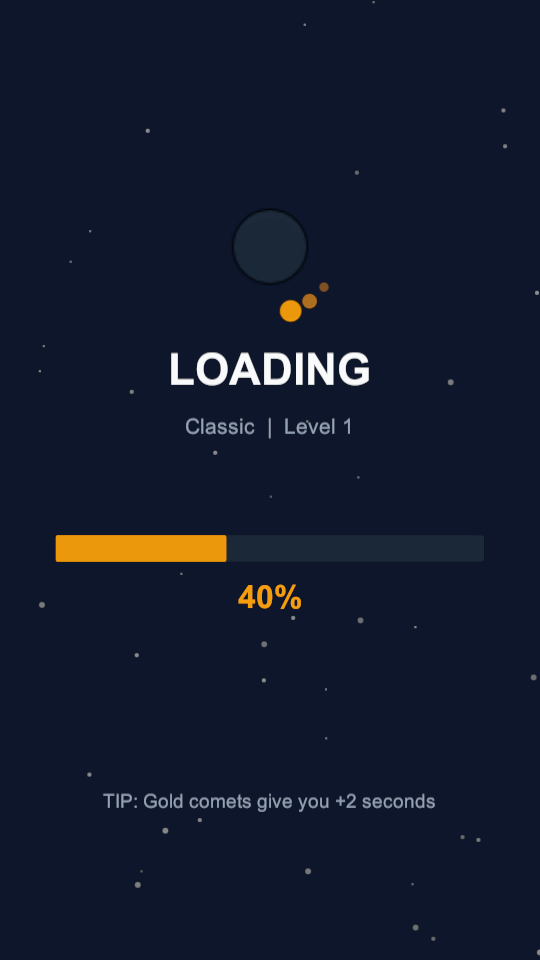
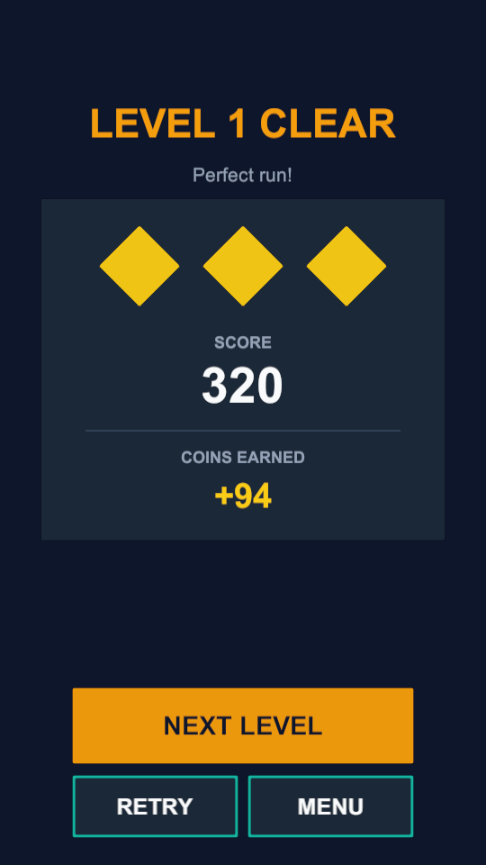

# Comet Run - Lab 08 (BSSE23041)

For Lab 08 I kept working on my Lab 07 project, Comet Run. In Lab 07 it was only the menu flow
with 10 screens and the gameplay screen was a fake HUD. For this lab I added a loading screen, a
small playable game, sound effects, music, an Audio Mixer with volume sliders, and C# events.
there are 11 screens.

Unity version: **6000.3.24f1** (builtin render pipeline, portrait, Android)

## Video Link : https://youtu.be/YgCkZ2I9ZaY

| Loading                  | Gameplay                  | Pause                  | Settings                  | Results                      |
| ------------------------ | ------------------------- | ---------------------- | ------------------------- | ---------------------------- |
|  |  |  |  |  |

## The game

It's very simple and only uses Unity's basic shapes. Orange balls (comets) fall down the screen
and you tap them for points. Gold balls are worth double and give you 2 extra seconds. The red
spinning cubes are asteroids, if you tap one you lose a life. You have 3 lives. The run is over
when the time runs out or you lose all your lives, and then the score gives you gems on the
Results screen like in Lab 07.

## The flow is:
Title > Main Menu > Mode > Level > Hangar > Loading > Gameplay > Results,
and from Gameplay you can open Pause, and Settings from Pause.

## Loading screen

Files: `Screens/LoadingScreen.cs`, `Game/GameSceneLoader.cs`

The menus are in `Main.unity` and the game is in a separate scene, `Gameplay.unity`. When you
press START RUN the loading screen opens and loads the game with `LoadSceneAsync`.

Some things about how it works:

- I load it with `LoadSceneMode.Additive`, so it gets added on top of the menu scene. This way
  my screen manager, pause, settings and results from Lab 07 didn't need to change at all.
- `allowSceneActivation` is false at first so the scene doesn't turn on by itself. Unity's
  progress stops at 0.9 when it's waiting, so I divide by 0.9 to show 0 to 100%.
- The bar moves smoothly but it never goes further than the real progress.
- When it reaches 100% I turn `allowSceneActivation` on, wait until it's done, and only then go
  to gameplay. There are no buttons on this screen and back doesn't work here, so you can't skip it.
- After the run (or if you quit from pause) the game scene gets unloaded again. Retry loads it again.

## Audio Mixer

File: `Assets/CometRun/Audio/GameMixer.mixer`


The -80 dB in the picture is only the meter because nothing was playing. The faders are at 0 dB
and the volume gets changed from code.

| Group  | What plays in it                | Exposed parameter |
| ------ | ------------------------------- | ----------------- |
| Master | the other 3 groups go into this | MasterVolume      |
| Music  | 2 music sources                 | MusicVolume       |
| SFX    | 4 gameplay sound sources        | SFXVolume         |
| UI     | 1 UI sound source               | UIVolume          |

So there are only 7 AudioSources in the whole game and each one has its output set to the right
group.

## Volume sliders

Files: `Audio/MixerVolumes.cs`, `Screens/SettingsScreen.cs`

In Settings there are 4 sliders now: Master, Music, Effects and UI Sounds. The slider goes from
0 to 1 but the mixer needs decibels. At first I thought about just doing it in a straight line
but then half the slider is almost silent, so I used log10 instead:

```csharp
public static float ToDecibels(float value)
{
    if (value <= 0.0001f) return -80f;   // log10(0) doesn't work, so 0 is just mute
    return Mathf.Max(-80f, Mathf.Log10(value) * 20f);
}
```

That gives 100% = 0 dB, 50% = about -6 dB, 10% = -20 dB and 0 = -80 dB (shows MUTE).

- The Music and Sound Effects switches from Lab 07 are still there, now they mute their group.
- The values are saved with PlayerPrefs (`vol_master`, `vol_music`, `vol_sfx`, `vol_ui`) so they
  are still the same after closing the game.
- I load them in `Start()` and not `Awake()` because `SetFloat` on the mixer doesn't work in Awake.

## Music

File: `Audio/MusicPlayer.cs`

There are two looping songs, a calm one for the menus and a faster one for the game. The music
player has two AudioSources so it can fade one out while the other fades in (about 1.2 seconds).
It switches to the game song when a run starts and back to the menu song when you get to
Results or quit from pause.

## Sound effects

UI sounds (`Audio/UIAudio.cs`): there's only one AudioSource for all UI sounds. Buttons don't
have their own, they just call `UIAudio.Play(...)`. My `ButtonFeedback` script was already on
every button from Lab 07 so I added the hover and click sounds there.

- hover (only with a mouse since phones don't have hover)
- click for buttons and switches
- back for back buttons, phone back key and Escape
- panel open and close when the pause panel opens or closes
- pause and resume
- success when you clear a level or buy something
- error for warnings like locked levels or not enough coins
- a little "ding" for each gem on the results screen

Gameplay sounds (`Game/GameAudio.cs`): collect, boost (gold comet), damage, death, a tick in the
last 3 seconds, "go" at the start, and a win and lose sound at the end.

They use `PlayOneShot` so if you tap fast the sounds can overlap. I also change the pitch a tiny
bit randomly so the same sound doesn't get annoying. Pitch is set on the AudioSource though, so if
there was only one source it would change the sounds that are still playing too. That's why
GameAudio has 4 sources and uses them one after another.

### Audio when paused

When you pause, `Time.timeScale` goes to 0 and `AudioListener.pause` is set to true (in
`GamePause.cs`). This is what I decided should happen:

- gameplay sounds stop
- music keeps playing but gets quieter
- UI sounds still work so the pause menu buttons still click

The music and UI sources have `ignoreListenerPause` ticked, that's why they keep going.

## C# events

The game logic is in `Game/GameSession.cs`. It doesn't play sounds or update the HUD itself, it
just fires events and other scripts listen to them.

Events: `GameStarted`, `Collected`, `TimeBonus`, `Damaged`, `Died`, `CountdownTick`, `GameWon`,
`GameLost`

Scripts that listen:

| Script            | What it does                                                                     |
| ----------------- | -------------------------------------------------------------------------------- |
| GameplayScreen    | updates score and lives, red flash when hit, shows GO! / TIME UP!, opens Results |
| GameAudio         | plays the gameplay sounds                                                        |
| HitParticles      | particles where you tapped                                                       |
| CameraShake       | shakes the camera when you get hit or die                                        |
| GameMusicSwitcher | changes the music when the run starts and ends                                   |

Declaring and calling the events (`GameSession.cs`):

```csharp
public event Action<int, Vector3> Damaged;   // lives left, where it happened
public event Action<Vector3> Died;

case TargetKind.Asteroid:
    Lives--;
    Damaged?.Invoke(Lives, pos);
    if (Lives <= 0)
    {
        DiedThisRun = true;
        Died?.Invoke(pos);
        EndRun();
    }
    break;
```

Subscribing and unsubscribing (`CameraShake.cs`):

```csharp
void OnEnable()
{
    session.Damaged += OnDamaged;
    session.Died += OnDied;
}

void OnDisable()
{
    session.Damaged -= OnDamaged;
    session.Died -= OnDied;
}
```

All the listeners do it like this, `+=` in OnEnable and `-=` in OnDisable.

## Testing

I played through the whole thing: menus, loading, playing a run, pausing, changing the sliders in
settings, resuming, restarting, finishing a run, retrying, losing all lives, going back to the menu,
and quitting from pause. I also closed and opened the game again to check the volume was saved.
There were no errors in the Console.

## Credits

I didn't use any downloaded sounds or music. I made all of them myself with a small Python script
(`Tools/make_audio.py`) that makes simple tones (sine, square, triangle and noise) and puts them
together. The music is just a short chord loop (Am, F, C, G) with bass, an arpeggio and simple drums.

| Files                          | Made by                      | Licence     |
| ------------------------------ | ---------------------------- | ----------- |
| ui\_\*.wav (10 sounds)         | me, with Tools/make_audio.py | my own, CC0 |
| sfx\_\*.wav (8 sounds)         | me, with Tools/make_audio.py | my own, CC0 |
| music_menu.wav, music_game.wav | me, with Tools/make_audio.py | my own, CC0 |
